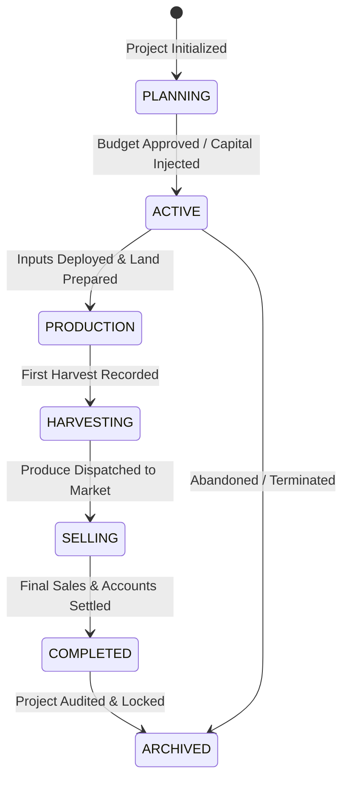
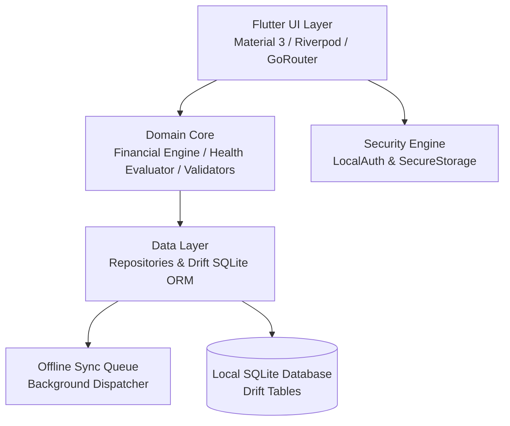

# Farm Project Manager (Farmivo)
## Product Requirements Document (PRD)

**Document Version:** 1.0  
**Status:** Approved Product Definition  
**Target Platform:** Flutter Mobile Application (Android & iOS)  
**Primary Market:** Ghana and West Africa (Expanding to Sub-Saharan Africa)  
**Architecture:** Offline-First, Local-First, Production-Grade  
**Primary Currency:** Ghanaian Cedi (GHS) with Minor-Unit (Pesewas) Integer Precision & Multi-Currency Capability  
**Target Users:** Smallholder farmers, commercial farmers, farm managers, agricultural entrepreneurs, and agribusiness investors.

---

## 1. Product Overview

### 1.1 Product Name & Identity
- **Working Name:** Farm Project Manager
- **Application Package / Brand Identity:** Farmivo
- **Tagline:** *"Plan smarter. Farm with numbers. Know your profit."*

### 1.2 Product Vision
Farm Project Manager is an offline-first agricultural financial planning, management, and decision-support mobile application. It empowers agricultural operators to answer five existential business questions:

1. **How much money will I need?** (Pre-season Budgeting & Capital Requirement)
2. **How much have I spent?** (Real-time Transactional & Labour Tracking)
3. **How much money am I making?** (Yield, Harvest, Sales, and Collections)
4. **Will this farm project be profitable?** (Break-even, Projected vs. Actual Profit, ROI)
5. **Should I continue, change, or stop this project?** (Algorithmic Health Scoring & Sensitivity Insights)

The application bridges the entire lifecycle:
$$\text{Planning} \longrightarrow \text{Budget} \longrightarrow \text{Expenses} \longrightarrow \text{Production} \longrightarrow \text{Harvest} \longrightarrow \text{Sales} \longrightarrow \text{Cash Flow} \longrightarrow \text{Profit} \longrightarrow \text{Decision}$$

---

## 2. Problem Statement
Many agricultural ventures in developing economies rely on paper notebooks, fragmented spreadsheets, or mental calculations. This creates systemic failures:
- Uncontrolled budget leakage and forgotten micro-expenses.
- Commingling of personal and enterprise funds.
- Inability to accurately quantify casual and permanent farm labour costs.
- Conflating cash received with actual enterprise profitability.
- Zero visibility into pre-harvest liquidity and cash traps.
- Inability to compute accurate break-even yield or prices.
- Inability to generate verifiable financial statements for banks, cooperatives, or investors.

**The Reality Gap:**
A farmer might estimate: *"I spent around GH₵10,000."*  
In reality: *"The project cost GH₵12,740, generated GH₵18,500 across 3 harvest cycles, achieved a 45.2% ROI, and experienced a 27.4% budget overrun driven primarily by unbudgeted weeding labour."*

Farm Project Manager converts guesswork into actionable financial intelligence.

---

## 3. Product Goals

### 3.1 Primary Functional Goals
- **Multi-Farm & Multi-Project Hierarchy:** Support multiple farms across regions and concurrent projects per farm.
- **Strict Distinction of Triple Values:** Maintain complete separation between **Planned**, **Actual**, and **Projected** figures.
- **Budgeting Engine:** Build pre-season, category-driven budgets with automatic minor-unit variance detection.
- **Transaction Tracking:** Record operational expenses with receipt capture, vendor tracking, and payment method attribution.
- **Production & Agronomic Logs:** Track farming activities (spraying, planting, fertilization) linked directly to cost centers.
- **Harvest vs. Sales Decoupling:** Record harvests independently from sales transactions.
- **Debtor & Receivables Tracking:** Manage buyers, payment statuses (Unpaid, Partial, Paid, Overdue), and credit aging.
- **Financial Analytics:** Compute Real-time Revenue, True Cost, Net Profit, ROI %, and Break-even points (quantity & price).
- **Project Health Engine:** Provide automated status ratings (**Healthy**, **Watch**, **At Risk**) with clear root-cause explanations.
- **100% Offline Capability:** All create, read, update, calculate, report, and export actions work without internet connectivity.
- **Security & Data Sovereignty:** Local biometric/PIN lock, immutable audit logging, automated local encrypted backups.
- **Decision Engine & Scenario Modeling:** Worst-case, expected, and best-case yield/price scenario planning.
- **Bank-Ready Exporting:** Produce professional PDF reports, CSV exports, and summary ledgers.

---

## 4. Non-Goals (Scope Boundaries for MVP)
To guarantee rapid execution and bulletproof stability, the MVP **explicitly excludes**:
- Enterprise Farm ERP (heavy supply chain logistics, multinational commodity shipping).
- Public B2B/B2C marketplace for goods or inputs.
- Social networking, farmer forums, or community messaging.
- Computer-vision-based automated crop disease diagnosis.
- Satellite-based hyperspectral weather forecasting.
- Equipment rental and machinery leasing marketplace.
- Direct digital banking, mobile-money wallet hosting, or payment escrow.
- Mandatory government agricultural reporting registrations.

---

## 5. Target User Personas

| Persona | Operational Context | Primary Needs | Critical Success Metric |
| :--- | :--- | :--- | :--- |
| **Smallholder Farmer** | 1–5 acres (e.g., maize, pepper, cassava). Intermittent internet; outdoor high-glare usage. | Simple budget, quick expense entry (<15s), harvest log, profit calculation. | Instant visibility into whether revenue exceeded all costs. |
| **Commercial Farmer** | 20+ acres or multi-crop/livestock operations running concurrently. | Multi-farm aggregation, cash flow projections, planned vs. actual variance analysis. | Accurate break-even and cross-project capital allocation. |
| **Agribusiness Entrepreneur** | Investing external capital into farming ventures. Evaluates projects before breaking ground. | Scenario modeling (conservative vs. optimistic), ROI projections, risk matrix. | Verifiable expected ROI and downside risk quantification. |
| **Farm Manager** | On-site overseer managing daily operations for absentee landowners. | Activity logging, casual labour tracking, receipt attachment, generating PDF reports. | Transparent expense audit trail and exportable owner reports. |

---

## 6. Core Product Principles

### 6.1 The Tri-Value Principle
The system enforces strict computational and visual separation between three states:
1. **Planned:** What the producer budgeted or assumed prior to spending.
2. **Actual:** Verifiable transactions recorded with historical timestamps.
3. **Projected:** Dynamic recalculation of the final outcome:
   $$\text{Projected Total Cost} = \text{Actual Incurred Cost} + \text{Remaining Planned Cost}$$
   $$\text{Projected Revenue} = \text{Actual Sales Collected} + \text{Remaining Unharvested Expected Yield} \times \text{Forecast Price}$$

### 6.2 Monetary Precision Principle
- Floating-point representations are strictly forbidden for currency storage and calculations.
- All monetary fields are stored as 64-bit integers in minor units (**Pesewas** for GHS, where $\text{GH₵}1.00 = 100\text{ pesewas}$).
- Multi-currency transactions must explicitly capture the ISO-4217 code and transaction-date exchange rate.

### 6.3 Decoupling Real-World Events
- **Harvest $\neq$ Sale:** An agricultural product harvested into storage is inventory, not revenue.
- **Sale $\neq$ Cash In:** Delivering produce to a buyer on credit creates an account receivable, not cash-in-hand.
- **Actuals Require Proof:** Budget allocations cannot be depleted by assumption; an actual expense requires a discrete transaction.

---

## 7. Project Lifecycle State Machine

- **Transitions:** Transitions can be manually initiated by the user or triggered by non-intrusive system suggestions (e.g., system suggests moving to `HARVESTING` when first harvest batch is logged).
- **Immutability upon Archive:** Completed/Archived projects lock financial ledgers to prevent retroactive tampering without generating an audit log.

---

## 8. Data Entities & Core Features

### 8.1 User & Farm Management
- **Local Profile:** Offline-first identity with optional full name, contact number, avatar, and preferred currency.
- **Farms:** Multi-farm management capturing Name, Location, District, Region, Country, GPS (Latitude/Longitude), Total Land Area, Unit (Acres, Hectares), Ownership Model (Owned, Family Land, Rented, Leased, Shared, Sharecropping/Abunu/Abusa).

### 8.2 Project Definition
- **Fields:** Project ID, Farm ID, Name, Project Type (Crop, Livestock, Aquaculture, Custom), Specific Variety/Breed, Cultivated Land Area, Start Date, Target Harvest Date, Currency, Status, Description, Notes.
- **Default Crop Templates:** Maize, Pepper, Tomato, Okra, Cassava, Yam, Rice, Onion, Soybean, Groundnut, Cocoa, Oil Palm.
- **Livestock Templates:** Poultry (Broilers/Layers), Goats, Sheep, Cattle, Pigs, Rabbits.
- **Aquaculture:** Tilapia, Catfish.

### 8.3 Budgeting & Planned Spending
- **Categories:** Land Preparation, Inputs (Seeds, Agro-chemicals, Fertilizers, Feed), Labour (Land prep, Planting, Spraying, Weeding, Harvesting), Equipment & Irrigation, Logistics (Transport, Storage, Bags), Utilities, Security & Overhead.
- **Budget Item:** Project ID, Category ID, Item Name, Planned Quantity, Unit, Unit Cost (minor units), Planned Total Amount.

### 8.4 Expense Tracking & Budget Variance
- **Fields:** Expense ID, Project ID, Budget Item ID (optional link), Category ID, Transaction Date, Amount (in minor units), Currency, Payment Method (Cash, Mobile Money - MTN/Telecel/AT, Bank Transfer, Vendor Credit), Vendor Name, Receipt Photo URI, Notes.
- **Variance Calculations:**
  $$\text{Variance Amount} = \text{Actual Amount} - \text{Planned Amount}$$
  $$\text{Variance \%} = \frac{\text{Actual Amount} - \text{Planned Amount}}{\text{Planned Amount}} \times 100$$
- **Alert Levels:**
  - 🟡 **Warning:** Category expenditure reaches $\ge 80\%$ of budget.
  - 🟠 **Critical:** Category expenditure reaches $100\%$ of budget.
  - 🔴 **Overrun:** Category expenditure exceeds $100\%$ of budget.

### 8.5 Production & Agronomic Activities
- **Fields:** Activity ID, Project ID, Activity Type (Ploughing, Sowing, Spraying, Fertilizer application, Weeding, Irrigation, Feeding, Vaccination, Harvesting), Date, Labourers Used, Duration (Hours/Days), Direct Cost (minor units), Status, Photo Attachments.
- **Auto-Expense Linking:** Users can toggle *"Log as expense"* directly from an activity entry.

### 8.6 Harvest & Storage Logs
- **Fields:** Harvest ID, Project ID, Batch Number, Date, Product Name, Harvested Quantity, Unit of Measure (kg, 50kg bag, 100kg bag, crate, bird, tonne), Grade/Quality (Grade A, B, Rejects), Storage Location, Notes.

### 8.7 Sales, Buyers & Receivables
- **Buyer Directory:** Buyer ID, Name, Phone Number, Enterprise/Market Name, Location, Historical Balance.
- **Sale Record:** Sale ID, Project ID, Harvest Batch Ref, Buyer ID, Date, Quantity, Unit, Unit Price (minor units), Gross Sale Amount, Payment Status (`PAID`, `PARTIAL`, `UNPAID`).
- **Payment Receipts:** Payment ID, Sale ID, Payment Date, Amount Paid (minor units), Payment Method, Reference Code.
- **Receivables Formula:**
  $$\text{Outstanding Balance} = \text{Gross Sale Amount} - \sum \text{Payments Received}$$

---

## 9. Financial Engine & Analytical Formulas

### 9.1 Profit Calculations
1. **Planned / Projected Profit:**
   $$\text{Projected Profit} = \text{Projected Revenue} - \text{Total Budgeted Cost}$$
2. **Actual Net Profit:**
   $$\text{Actual Net Profit} = \text{Recorded Sales Revenue} - \text{Total Incurred Actual Expenses}$$
3. **Cash-Basis Profit:**
   $$\text{Cash Profit} = \text{Cash Collected} - \text{Cash Disbursed}$$

### 9.2 Return on Investment (ROI)
$$\text{Actual ROI \%} = \left( \frac{\text{Actual Net Profit}}{\text{Total Incurred Cost}} \right) \times 100$$
$$\text{Projected ROI \%} = \left( \frac{\text{Projected Net Profit}}{\text{Total Budgeted Investment}} \right) \times 100$$

### 9.3 Break-Even Analysis
1. **Break-Even Revenue:** Total expenditure required to recover investment:
   $$\text{Break-Even Revenue} = \text{Total Project Costs (Actual or Budgeted)}$$
2. **Break-Even Output / Yield:** Minimum volume needed at anticipated unit price:
   $$\text{Break-Even Quantity} = \frac{\text{Total Cost}}{\text{Unit Selling Price}}$$

### 9.4 Project Health Scoring Algorithm (0–100)
A composite algorithm evaluates active projects:
$$\text{Score} = w_1(\text{Budget Variance}) + w_2(\text{Revenue Execution}) + w_3(\text{Cash Liquidity}) + w_4(\text{Schedule Drift}) + w_5(\text{Credit Risk})$$
- **Score $\ge 80$:** 🟢 **Healthy** (Proceed normally)
- **Score $60 - 79$:** 🟡 **Watch** (Noticeable variance, cost creeps, slow sales)
- **Score $< 60$:** 🔴 **At Risk** (Budget overruns $>20\%$, yield failure, critical cash shortage)

---

## 10. Offline-First Architecture & Data Integrity

### 10.1 Storage Engine
- **Engine:** SQLite managed via **Drift** (strongly-typed Dart ORM).
- **Transactions:** All multi-step financial entries execute inside atomic database transactions.
- **Immutability & Correction:** Financial records default to soft-deletions / voiding with recorded reasons rather than hard deletes.
- **Audit Log:** Any modification to confirmed transactions logs the original value, modified value, timestamp, and user.

### 10.2 Future Cloud Synchronization Protocol
- **Local Ledger $\longrightarrow$ Sync Queue $\longrightarrow$ Network Worker $\longrightarrow$ API Server**.
- **Conflict Resolution:** Last-Write-Wins (LWW) for metadata; additive append-only conflict resolution for transactional ledgers.

---

## 11. User Experience & Field Usability

- **Quick-Entry Mode:** High-frequency actions (`+ Expense`, `+ Sale`, `+ Harvest`) must complete in under **15 seconds** with $\le 4$ taps.
- **High-Contrast Outdoor Theme:** Large typography (Material Design 3 Type Scale), deep blacks, high-contrast greens/ambers/reds, readable under direct African sunlight.
- **Touch Targets:** Minimum interactive target dimension $\ge 48 \times 48\text{ dp}$.
- **Accessibility:** Text labels accompany all status badges; color is never used as the single signifier of financial health.

---

## 12. Security & Compliance
- **Application Lock:** Biometric (Fingerprint / Face Unlock via `local_auth`) and secure 4–6 digit fallback PIN.
- **Secure Keystore:** Keyring credentials and security salts stored via `flutter_secure_storage` (Android Keystore / iOS Keychain).
- **Data Export & Privacy:** Zero transmission of financial records without explicit user consent. Standard local database backup to encrypted file format.

---

## 13. System Architecture Diagram

