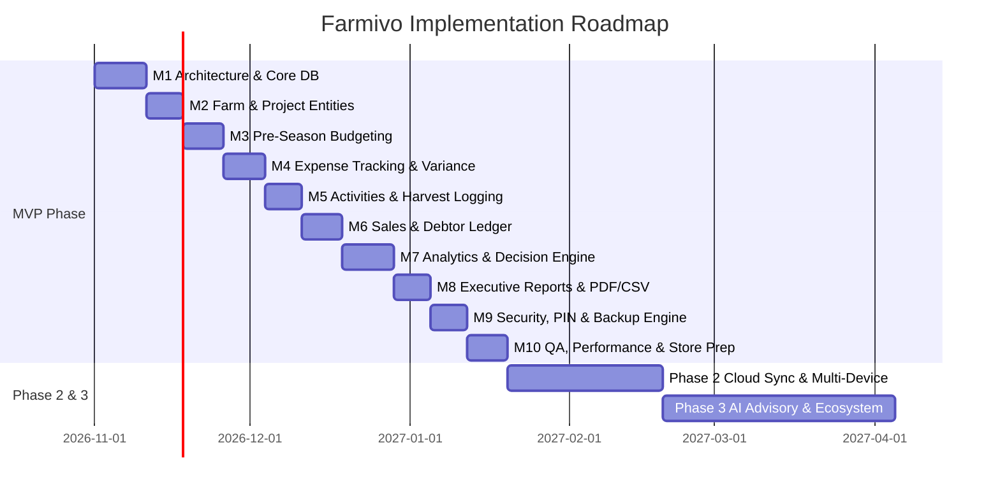

# Farm Project Manager (Farmivo)
# Implementation Roadmap & Engineering Plan

**Version:** 1.0.0  
**Target Architecture:** Flutter / Dart (Clean & Feature-First) + Riverpod + Drift SQLite  
**Execution Horizon:** MVP (Milestones 1–10) $\longrightarrow$ Phase 2 (Cloud & Scale) $\longrightarrow$ Phase 3 (AI & Ecosystem)

---

## Executive Summary & Milestones Overview

---

## Milestone 1: Architectural Foundation & Core Setup

### Objectives
Establish the production-grade Flutter codebase architecture, dependency injection, routing, theme system, cryptographic storage, and Drift SQLite foundation.

- [x] **1.1 Directory Structure Scaffolding**
  - Implement feature-first organization: `app/`, `core/`, `features/`, `data/`, `shared/`.
  - Establish barrel exports and strict boundary isolation.
- [x] **1.2 Core Dependencies & Environment Configuration**
  - Add core libraries: `flutter_riverpod`, `riverpod_annotation`, `drift`, `sqlite3_flutter_libs`, `path_provider`, `go_router`, `freezed_annotation`, `flutter_secure_storage`, `local_auth`, `uuid`, `intl`, `logger`, `crypto`.
  - Configure dev dependencies: `build_runner`, `drift_dev`, `riverpod_generator`, `freezed`, `json_serializable`.
- [x] **1.3 High-Contrast Outdoor Theme & Design System**
  - Material 3 theme with high contrast tokens designed for intense outdoor sunlight.
  - Dark mode and OLED high-contrast mode.
  - Define minimum touch targets ($48 \times 48\text{ dp}$) and responsive typography.
- [x] **1.4 Declarative Navigation (`go_router`)**
  - Setup typed routes with deep link readiness.
  - Bottom navigation bar: Home / Projects / Transactions / Reports / Settings.
  - Route guards for PIN/Biometric lock and onboarding state.
- [x] **1.5 Drift SQLite Database Engine Setup**
  - Initialize Drift database class (`AppDatabase`) with connection pooling and background isolate execution.
  - Implement base entity conventions: `id` (UUID v4), `created_at`, `updated_at`, `is_synced`, `is_deleted`.
  - Set up SQLite schema migration harness.
- [x] **1.6 Monetary Value Objects & Precision Math**
  - Create `Money` value object storing amount in minor units (`BigInt` / `int` in pesewas).
  - Implement currency formatting, formatting for GHS (`GH₵`), USD, NGN, and parsing utility with error tolerance.
- [x] **1.7 Error Handling & Diagnostic Logging**
  - Unified `AppFailure` hierarchy with user-friendly error messages (no raw SQL crash text).
  - Production logging infrastructure with rotation.

#### Milestone 1 Acceptance Criteria
- App compiles cleanly with strict lint rules.
- Database opens, creates default tables, and handles transactions in background isolates.
- Shell route with 5 bottom tabs transitions fluidly.
- `Money` class handles addition, subtraction, multiplication, and formatting with zero floating-point artifacts.

---

## Milestone 2: Farm & Project Management Module

### Objectives
Enable farmers to register agricultural properties and launch distinct, tracked farm projects across crops, livestock, aquaculture, and custom types.

- [x] **2.1 Farm Management**
  - Schema: `FarmsTable` (id, name, location, district, region, country, latitude, longitude, total_area, area_unit, ownership_type, notes).
  - UI: Farm list, add/edit farm dialog with validation, photo attachment support.
  - Support customary Ghanaian tenure types: Owned, Family Land, Rented, Leased, Abunu, Abusa.
- [x] **2.2 Project Creation & Lifecycle**
  - Schema: `ProjectsTable` (id, farm_id, name, type, commodity, variety, size, size_unit, start_date, expected_harvest_date, currency, status, notes).
  - Project Type Presets:
    - Crops: Maize, Pepper, Tomato, Okra, Cassava, Yam, Rice, Onion, Soybean, Groundnut, Cocoa, Oil Palm.
    - Livestock: Poultry (Broilers/Layers), Goats, Sheep, Cattle, Pigs, Rabbits.
    - Aquaculture: Tilapia, Catfish.
    - Custom user-defined commodity.
- [x] **2.3 Project State Machine Transition Logic**
  - States: `PLANNING` $\to$ `ACTIVE` $\to$ `PRODUCTION` $\to$ `HARVESTING` $\to$ `SELLING` $\to$ `COMPLETED` $\to$ `ARCHIVED`.
  - Status transition triggers, validation checks (e.g. prompt to advance when harvest is logged).
- [x] **2.4 Project Detail Hub & Quick Overview**
  - Project dashboard header with vital metrics: Days active, Current stage, Total spent, Projected yield.
  - Sub-navigation: Overview, Budget, Expenses, Activities, Harvests, Sales, Financials.

#### Milestone 2 Acceptance Criteria
- Create multiple farms with different measurement units (Acres, Hectares).
- Create multi-crop and livestock projects under a single farm.
- Lifecycle transitions persist and enforce domain validation rules.

---

## Milestone 3: Pre-Season Budgeting Engine

### Objectives
Empower producers to plan comprehensive capital requirements and project financial viability before spending money.

- [x] **3.1 Budget Categories & Standard Taxonomy**
  - Standard categories: Land Preparation, Inputs (Seed, Chemical, Fertilizer, Feed), Labour, Equipment & Irrigation, Logistics & Storage, Utilities, Overheads/Other.
  - Allow user-created custom budget categories.
- [x] **3.2 Budget Item Configuration**
  - Schema: `BudgetItemsTable` (id, project_id, category_id, name, quantity, unit, unit_cost_minor, planned_amount_minor, notes).
  - Dynamic formula: $\text{Planned Amount} = \text{Quantity} \times \text{Unit Cost}$.
  - Support minor unit currency input with immediate calculation.
- [x] **3.3 Revenue & Yield Forecast Modeler**
  - Input expected yield (quantity + unit) and estimated unit selling price.
  - Calculate Projected Gross Revenue: $\text{Yield} \times \text{Price}$.
  - Compute Pre-season Projected Profit & ROI %:
    $$\text{Projected Profit} = \text{Projected Revenue} - \text{Total Budgeted Cost}$$
- [x] **3.4 Break-Even Yield & Price Calculator**
  - Break-even Quantity = Total Budgeted Cost $\div$ Expected Unit Price.
  - Break-even Price = Total Budgeted Cost $\div$ Expected Yield.
  - Visual summary card indicating the required threshold to protect invested capital.

#### Milestone 3 Acceptance Criteria
- Farmers can create a complete multi-category budget in under 3 minutes.
- Calculation of projected profit, ROI, and break-even points updates reactively as inputs change.
- Stored as integers in minor units; no rounding errors.

---

## Milestone 4: Operational Expense Management & Variance Engine

### Objectives
Deliver frictionless expense tracking (<15 seconds per entry) and automated planned vs. actual variance analysis with visual budget guardrails.

- [x] **4.1 Fast Expense Entry Flow (<15 seconds)**
  - Schema: `ExpensesTable` (id, project_id, budget_item_id, category_id, date, amount_minor, currency, payment_method, vendor, receipt_path, notes, is_voided).
  - Optimized form: Default date to today, fast numerical numpad, quick category selector, auto-suggest vendors.
  - Payment methods: Cash, Mobile Money (MTN MoMo, Telecel Cash, AT Money), Bank Transfer, Credit.
  - Local receipt photo capture and compressed storage.
- [x] **4.2 Budget Allocation Linking & Tracking**
  - Optional linking of expense to specific pre-season budget item.
  - Direct calculation of actual spent per category and item from transactional records.
- [x] **4.3 Real-time Planned vs. Actual Variance Engine**
  - Calculate $\text{Variance} = \text{Actual} - \text{Planned}$ and $\text{Variance \%} = (\text{Variance} / \text{Planned}) \times 100$.
  - Automated Threshold Alerts:
    - 🟡 **Warning:** Category expenditure reaches $\ge 80\%$.
    - 🟠 **Critical:** Category expenditure reaches $100\%$.
    - 🔴 **Overrun:** Category expenditure exceeds budget ($>100\%$).
- [x] **4.4 Transaction Ledger & Filtering**
  - Filter by Project, Date Range, Category, Payment Method, Amount Range.
  - Full-text search on vendor and description.
  - Voiding mechanism: Void transaction with recorded reason instead of physical database deletion.

#### Milestone 4 Acceptance Criteria
- Benchmark: Complete recording of an expense with category and payment method in $\le 15$ seconds.
- Real-time update of category progress bars and overrun alerts.
- Voiding keeps an immutable trail and recalculates budget spent instantly.

---

## Milestone 5: Agronomic Activities & Harvest Tracking

### Objectives
Track farm field operations, casual labour allocation, and harvest inventory completely decoupled from sales.

- [x] **5.1 Farm Activity Logging**
  - Schema: `ActivitiesTable` (id, project_id, activity_type, title, date, labour_count, duration_hours, cost_minor, status, notes).
  - Activity types: Land Preparation, Planting, Weeding, Spraying, Fertilizing, Irrigation, Feeding, Vaccination, Harvesting.
  - Option to auto-generate corresponding Expense record for activity labour cost.
- [x] **5.2 Harvest Logging (Inventory Capture)**
  - Schema: `HarvestsTable` (id, project_id, batch_number, date, product_name, quantity, unit, grade, storage_location, notes).
  - Aggregation engine: Computes cumulative yield per crop, comparison against projected yield.
  - Grade and quality tracking (Grade A, Grade B, Rejects) for yield quality analysis.

#### Milestone 5 Acceptance Criteria
- Record field activity with labour counts and link directly to cash expenses.
- Multiple harvests logged under one project aggregate seamlessly into Total Production volume.
- Clear UI distinction between harvested crop in inventory and sold crop.

---

## Milestone 6: Commercial Sales, Buyers & Receivables Ledger

### Objectives
Manage commercial produce sales, customer relations, debt collection, and credit tracking.

- [x] **6.1 Customer & Buyer Directory**
  - Schema: `BuyersTable` (id, name, phone, business_name, location, notes).
  - Real-time calculation of total purchased, total paid, and outstanding debtor balance per buyer.
  - Fast-dial / SMS shortcut to contact buyers for debt collection.
- [x] **6.2 Sales Transactions Engine**
  - Schema: `SalesTable` (id, project_id, harvest_id, buyer_id, date, quantity, unit, unit_price_minor, total_amount_minor, payment_status, notes).
  - Payment statuses: `PAID`, `PARTIAL`, `UNPAID` (Credit).
- [x] **6.3 Payment Records & Installments**
  - Schema: `PaymentsTable` (id, sale_id, payment_date, amount_minor, payment_method, reference_no, notes).
  - Support multiple installment payments against a single sale.
  - Auto-updating balance: $\text{Outstanding} = \text{Total Sale} - \sum \text{Payments}$.
- [x] **6.4 Separation of Sales vs. Collected Cash**
  - Distinct dashboard metrics:
    - **Gross Sales Value:** Total value of produce sold.
    - **Collected Revenue:** Liquid cash received into accounts.
    - **Accounts Receivable:** Money owed by market buyers.

#### Milestone 6 Acceptance Criteria
- Log credit sales and record multiple payment installments across dates.
- Buyer directory displays outstanding balances accurately.
- Financial dashboards show collected cash distinct from accrued sales revenue.

---

## Milestone 7: Financial Analytics & Algorithmic Decision Engine

### Objectives
Synthesize planning, operational expenses, production yield, and sales revenue into actionable decision intelligence.

- [x] **7.1 Multi-Dimensional Profitability Engine**
  - **Actual Net Profit:** $\text{Actual Sales Revenue} - \text{Actual Expenses}$.
  - **Cash Profit:** $\text{Cash Collected} - \text{Cash Disbursed}$.
  - **Projected Final Profit:** $\text{Actual Incurred} + \text{Remaining Estimated Costs}$ vs. $\text{Sales} + \text{Remaining Anticipated Revenue}$.
  - **Actual ROI %** and **Projected ROI %** calculated with explicit badges.
- [x] **7.2 Dynamic Break-Even Analysis**
  - Current break-even status based on actual costs to date vs. sales and cash collected ($C_{\text{spent}}$ vs $S_{\text{sales}}$ and $S_{\text{collected}}$).
  - Unrecovered capital deficit calculation ($\max(0, C_{\text{spent}} - S)$).
  - Remaining units (kg/bags/crates/birds) required to achieve accrual and liquid cash break-even:
    $$\text{Remaining Units} = \frac{\text{Unrecovered Deficit}}{\text{Effective Unit Price}}$$
  - Feasibility assessment: compare remaining units needed against remaining anticipated harvest yield (`achieved`, `onTrack`, `shortfallRisk`).
  - Division-by-zero protection, zero-cost, and zero-revenue safe guards.
  - UI: `DynamicBreakEvenCard` embedded into `ProjectFinancialsTab` with dual recovery progress, deficit tiles, and plain-text advisory engine.
- [x] **7.3 Scenario Planning Modeler**
  - 3-scenario sensitivity matrix:
    1. **Conservative (Worst Case):** $-20\%$ Yield, $-15\%$ Price.
    2. **Expected Case:** Budgeted target assumptions.
    3. **Optimistic (Best Case):** $+15\%$ Yield, $+10\%$ Price.
  - Downside capital exposure evaluation: calculates maximum capital at risk ($\text{Downside Deficit} = \max(0, C - \text{Revenue}_{\text{cons}})$) and capital exposure \%.
  - Risk classification engine: `DownsideExposureRisk.robust`, `moderate`, `high` with outdoor badges (`ROBUST DOWNSIDE DEFENSE`, `MODERATE CAPITAL RISK`, `HIGH DOWNSIDE EXPOSURE`).
  - Atomic multi-scenario persistence in SQLite (`ScenariosTable`) via `ForecastRepository.saveScenarioMatrix`.
  - UI: `ScenarioPlanningCard` with 3-column comparative matrix, net return, ROI %, downside defense banner, and scenario modeler integration in `ProjectFinancialsTab`.
- [x] **7.4 Algorithmic Project Health Scoring Engine (0–100)**
  - Health criteria:
    - Budget Discipline (variance weighting): $30\%$
    - Revenue Performance (sales vs. projection): $25\%$
    - Cash Liquidity (cash flow buffer): $20\%$
    - Operational Schedule Drift: $15\%$
    - Credit Risk (uncollected receivables ratio): $10\%$
  - Health Badges: 🟢 **Healthy** ($\ge 80$), 🟡 **Watch** ($60 - 79$), 🔴 **At Risk** ($<60$).
  - **Explicit Explanation Engine:** Always outputs clear plain-text reasons (e.g., *"Project is At Risk because labour costs exceeded budget by 34% and 40% of sales remain uncollected"*).
  - UI: `ProjectHealthScoreCard` integrated into `ProjectFinancialsTab` featuring 5 weighted criteria breakdown bars, score gauge (0–100), status badge, and diagnostic explanation banner.
- [x] **7.5 Project Comparison Matrix**
  - Side-by-side comparison of active and past projects across: Land size, Capital invested, Total revenue, Net profit, ROI %, Cycle duration.
  - Multi-project comparative calculations: Top ROI performer badge, highest revenue project, most capital-efficient venture (profit / land unit), and portfolio aggregate totals.
  - Interactive UI: `ProjectComparisonScreen` with multi-project selection, stage filters (`All`, `Active`, `Past / Completed`), and `ProjectComparisonMatrixCard` comparative grid with diagnostic insights narrative.
  - Direct navigation entry points: AppBar and summary banner actions in `ProjectsScreen`, quick-compare action in `ProjectFinancialsTab`, and dedicated route `AppRoutes.projectComparison`.

#### Milestone 7 Acceptance Criteria
- Unit tests verify all formulas against edge cases (zero revenue, division by zero, negative profit).
- Health score dynamically updates with clear, color-independent textual explanations.
- Scenario comparison gives farmers instant risk visibility before committing capital.

---

## Milestone 8: Executive Reports & Data Export (PDF/CSV)

### Objectives
Enable farmers and managers to generate bank-ready, cooperative-ready, and investor-grade financial reports and spreadsheets offline.

- [x] **8.1 Charting & Visual Analytics**
  - Integrated `fl_chart` visualizations:
    - **Expense breakdown by category (Donut chart):** `ExpenseCategoryDonutChart` with proportional slices, touch response, center grand total and active share label, and color-coded legend with percentages.
    - **Planned vs. Actual spending comparison (Grouped bar chart):** `BudgetVsActualBarChart` paired rods per category with auto-scaling, overrun color highlights, and variance breakdown table.
    - **Cash flow trend over time (Cumulative line chart):** `CashFlowTrendLineChart` tracking chronological cumulative cash in vs. cash out with automated **Cash Break-Even crossover detection** and status notification banner.
    - **Cross-project financial comparison (Grouped bar chart):** `ProjectComparisonBarChart` side-by-side grouped bars for Capital Invested, Gross Revenue, and Net Profit across ventures.
  - Interactive Container Screen: `ReportsScreen` with dynamic scope selection (All Projects Portfolio vs. individual project), executive KPI summary cards, all 4 visual analytics charts, and action banner for bank-ready exports (Milestones 8.2 and 8.3).
  - Domain models: `CategoryExpenseShare` with 10-color calibrated palette, and `CashFlowPoint.buildTimeline` with midnight date grouping and cumulative cash position tracking.
- [x] **8.2 Bank-Ready PDF Financial Report Generator**
  - Offline PDF generation via `pdf` and `printing` packages with vector styling and built-in offline typography (`pw.Font.helvetica`).
  - Comprehensive 3+ page statement incorporating all 7 audited sections:
    1. **Farm & Project Executive Profile:** Venture specifications, land size, and 4 highlight KPI cards (Capital Deployed, Gross Turnover, Net Accrual Profit, Health Score).
    2. **Comprehensive Budget vs. Actual Variance Ledger:** Category subtotals, line-item planned vs. spent tracking, and overrun threshold alerts.
    3. **Production & Harvest Yield Log:** Harvest batches by date, quantity, quality grading (`HarvestGrade`), and destination/storage reconciliation.
    4. **Sales, Collections & Outstanding Debtors:** Debtors aging summary, sales ledger, cash collection efficiency %, and open buyer credit balances.
    5. **Profitability & Financial Return Statement:** Formal Agricultural P&L statement (Revenue, COGS, Net Operating Profit, Cash-basis profit) and return ratios (ROI %, Margin %, Return / Land Unit).
    6. **Dynamic Break-Even & Risk Sensitivity Analysis:** Production volume required to break even, unit cost of production, downside capital sensitivity, and algorithmic health diagnosis.
    7. **Audit Verification & Formal Sign-Off:** Dual signature blocks (Operator and Loan Officer/Auditor) and physical stamp/seal box.
  - Interactive UI & Workflow:
    - `PdfReportPreviewScreen` (`/reports/pdf-preview/:projectId`) with full document preview, sharing (`Printing.sharePdf`), and print layout.
    - `ExportOptionsSheet` bottom sheet to configure target venture, signatories, remarks, and signature blocks.
    - Direct entry points from `ReportsScreen` and `ProjectFinancialsTab`.
  - Domain model: `ProjectReportData` aggregate DTO and `PdfReportGenerator` pure Dart generation engine.
- [x] **8.3 CSV & Excel Data Export**
  - Export raw ledgers to standardized, Excel/Sheets-compatible CSV files with UTF-8 Byte Order Mark (`\uFEFF`) to prevent character encoding issues on Excel Windows/Mac:
    1. **Expenses Ledger (`${project}_Expenses_Ledger.csv`):** Expense ID, Date, Project, Category, Description, Quantity, Unit, Amount, Currency, Payment Method, Vendor, Receipt Attached, Status, Void Reason, Notes.
    2. **Sales & Debtors Ledger (`${project}_Sales_Ledger.csv`):** Sale ID, Date, Project, Commodity, Buyer, Quantity, Unit, Unit Price, Total Agreed Value, Cash Paid, Remaining Balance, Currency, Payment Status (PAID/PARTIAL/UNPAID), Notes.
    3. **Harvest Yield Log (`${project}_Harvest_Yield_Log.csv`):** Harvest ID, Date, Project, Batch Number, Produce/Crop, Quantity, Unit, Quality Grade, Storage Location, Notes.
    4. **Budget & Variance Ledger (`${project}_Budget_Variance_Ledger.csv`):** Project ID, Project Name, Category, Line Item, Target Quantity, Unit, Planned Amount, Actual Spent, Variance, % Spent, Alert Status, Currency.
    5. **Complete Audit Pack (All 4 Ledgers):** Multi-file concurrent export packaging all 4 ledgers into one system share action.
  - Native offline OS system share sheet distribution via `share_plus` (WhatsApp, Email, Google Drive, Bluetooth, save to local files).
  - Integration into UI: `ExportOptionsSheet` segmented tab switcher (Bank-Ready PDF vs. Excel/CSV Ledgers), target project picker, ledger selector with custom two-line preview, Excel compatibility advisory, and export action.
  - Services & state: `CsvReportGenerator` pure Dart generator, `CsvExportService` file writer & share distributor, `report_export_providers.dart` Riverpod providers.

#### Milestone 8 Acceptance Criteria
- [x] Generate and preview a 3-page comprehensive PDF report in $<2$ seconds on a mid-range device without internet.
- [x] Exported CSV files open properly formatted in Microsoft Excel and Google Sheets.

---

## Milestone 9: Security, Local Resilience & Backup Engine

### Objectives
Protect confidential financial data on mobile devices, prevent accidental data loss, and maintain an immutable audit trail.

- [x] **9.1 Biometric & PIN Security**
  - Fingerprint / Face ID unlock using `local_auth` with automatic hardware availability detection and enrolled credentials checks (`BiometricAuthService`).
  - Fallback custom numeric 4–6 digit PIN hashed with cryptographically secure random salt using iterative SHA-256 (1,000 rounds) and constant-time string comparison (`PinHasher`) persisted in `flutter_secure_storage` (`SecurityRepository`).
  - Configurable auto-lock timeout (Immediate on exit, 1 min, 5 min, 15 min, Never) with app lifecycle monitoring (`WidgetsBindingObserver` in `FarmivoApp` and `AppLockController`).
  - Security lock screens and UI:
    - Fullscreen `LockScreen` with security shield branding, `PinDisplayDots` with animated error shake, custom tactile `NumericKeypad`, biometric shortcut, and progressive brute-force rate-limiting lockout (30s cooldown after 5 failed attempts).
    - `SecuritySettingsScreen` accessible from Settings with application lock toggle, two-step PIN creation & confirmation bottom sheet, biometric toggle, and auto-lock timeout dialog.
    - GoRouter integration via `route_guards.dart` protecting all financial routes when locked.
- [x] **9.2 Local Database Backup & Restore Engine**
  - One-tap SQLite snapshot export to single-file encrypted backup archive (`.farmivo` / `.json.gz`) with 8-byte magic header (`FARMIVO1`), GZip compression, SHA-256 integrity checksum, and metadata envelope (`BackupArchiveEncoder`).
  - Atomic transactional restore engine (`BackupRestoreService`):
    - Flushes WAL (`PRAGMA wal_checkpoint(TRUNCATE)`) and queries all 16 Drift tables.
    - Automatic pre-restore database checkpointing with safety rollback preventing data loss on corrupted imports.
    - Temporary foreign key constraint relaxation with post-restore integrity check (`PRAGMA foreign_key_check`).
  - Automatic weekly local backup prompts (`isWeeklyBackupDue` tracking in `FlutterSecureStorage` with visual alert banner).
  - UI & native distribution:
    - Dedicated `BackupScreen` (`/settings/backup`) accessible from Settings with hero one-tap backup card, local snapshot list with file sizes and record counts, 1-tap restore with safety confirmation dialog, and deletion.
    - Native OS system share sheet distribution via `share_plus` (WhatsApp, Email, Google Drive, Bluetooth, save to files).
- [x] **9.3 Immutable Audit Logging**
  - Drift SQLite `AuditLogsTable` (id, entity_table, entity_id, action, previous_state_json, new_state_json, performed_by, reason, timestamp) with reverse chronological indexes.
  - Append-only repository contract (`AuditLogRepository` and `AuditLogRepositoryImpl`) enforcing immutable persistence with no mutation or deletion capabilities.
  - Financial domain voiding and adjustment audit integration:
    - `ExpenseRepositoryImpl.voidExpense`: immutably logs previous state, voided state, reason, and timestamp.
    - `SaleRepositoryImpl.voidSale`: immutably captures cancelled commercial sale value, product details, payment status, and reason.
    - `PaymentRepositoryImpl.voidPayment`: immutably logs payment amount void, balance adjustments, and dishonored payment reasons.
  - Audit presentation & inspection:
    - Dedicated `AuditLogScreen` (`/settings/audit-logs`) with informational forensic badge, action filter chips (`ALL`, `VOID`, `UPDATE`, `CREATE`, `DELETE`), and entity filter chips (`All`, `Expenses`, `Sales`, `Payments`).
    - Expandable `AuditLogTile` with action badges, reason callouts, and field diff breakdown (struck-through old value $\longrightarrow$ highlighted new value).
    - `EntityAuditTrailSheet` modal bottom sheet displaying complete audit history for individual records.
    - GoRouter registration and `SettingsScreen` integration with 13/13 unit and widget tests passing.
- [x] **9.4 Emergency Data Wipe & Factory Reset**
  - Atomic database truncation service (`DataWipeService`):
    - Truncates all 16 Drift tables with temporary foreign key constraint relaxation and flushes SQLite WAL.
    - Reseeds default agricultural budget categories taxonomy (`seedDefaultBudgetCategories()`).
    - Purges all secure storage keys (`flutter_secure_storage.deleteAll()`): PIN hash, salt, biometric preferences, auto-lock timeouts, background timestamps, and onboarding status.
    - Optional local backup directory erasure (`.farmivo` snapshot files).
  - Multi-step security confirmation guardrails:
    - Dedicated `DataWipeConfirmationDialog` with danger warning banner and clear consequences inventory.
    - Mandatory `"RESET"` challenge text matching verification.
    - Active PIN verification barrier if application lock is enabled (`verifyWipeAuthorization`).
    - Destructive button lockout until both challenge and PIN verification criteria are satisfied.
  - Runtime state reset and route redirection:
    - Resets `authLockProvider`, `onboardingCompletedProvider`, and refreshes `securitySettingsProvider`.
    - Seamless redirection to `AppRoutes.onboarding` for a fresh initial app setup.
  - Comprehensive unit and widget testing with 7/7 tests passing.

#### Milestone 9 Acceptance Criteria
- [x] Unlocking with biometrics and PIN passes security penetration checks.
- [x] Complete database restore successfully reconstructs 100% of projects, transactions, and audit records.
- [x] Emergency factory reset completely purges all sensitive records, audit trails, and PINs, returning the application to an unconfigured onboarding state.

---

## Milestone 10: Production Hardening, Quality Assurance & Store Release

### Objectives
Ensure stability, 60fps UI performance under 10,000+ records, complete test coverage, and app store deployment.

- [x] **10.1 Comprehensive Automated Test Suite**
  - **Financial Math & Algorithms:** Unit test suite (`test/core/financial_math_comprehensive_test.dart`, 19 tests) covering minor-unit pesewas conversions without IEEE-754 drift, 10,000 micro-transaction accumulation, multi-million capitalization bounds, multi-currency string parsing tolerance (GHS, USD, EUR, NGN, KES), negative accounting formatting, break-even calculus with zero-price argument guards, budget variance formulas, and the 5-factor weighted project health scoring engine (healthy, watch, at-risk).
  - **Database Integration & SQLite Integrity:** Drift database integration test suite (`test/data/database_integration_test.dart`, 3 tests) verifying atomic transaction rollbacks upon unexpected exceptions, foreign key constraint enforcement across parent-child dependencies, and cascade soft-voiding integrity.
  - **Critical Workflows:** Multi-step widget and screen validation for fast expense entry (`add_expense_screen_test.dart`), project creation & dashboard management (`project_ui_test.dart`), and commercial sale recording with debtor installment logging (`record_sale_screen_test.dart`).
  - **End-to-End Lifecycle:** Comprehensive real-world agricultural season integration test (`test/e2e/full_season_lifecycle_e2e_test.dart`, 15 sequential steps) simulating pre-season planning $\longrightarrow$ budgeting $\longrightarrow$ agronomic field activities $\longrightarrow$ operating expenses $\longrightarrow$ mid-season forensic audit voiding $\longrightarrow$ crop harvest batching $\longrightarrow$ commercial wholesale sales contract $\longrightarrow$ installment debtor payments $\longrightarrow$ CSV report export $\longrightarrow$ encrypted backup archive export $\longrightarrow$ emergency factory reset $\longrightarrow$ full database recovery verification.
- [x] **10.2 Stress & Performance Benchmarks**
  - **High-Volume SQLite Stress Benchmark Suite (`test/benchmarks/database_stress_benchmark_test.dart`, 7 tests):**
    - Seeded and benchmarked synthetic dataset consisting of 105 projects, 10,500 expenses, 5,250 sales, 2,625 debtor installment payments, 1,050 harvest batches, 2,100 activities, and 2,000 audit log entries.
    - Verified query plan optimization via `EXPLAIN QUERY PLAN` showing zero sequential table scans (`SCAN`) and active B-Tree index utilization (`USING INDEX idx_expenses_project`, `USING INDEX idx_sales_project`, `USING INDEX idx_payments_sale`).
    - Sub-second project metrics computation across active enterprises ($<150\text{ ms}$ per project, $<50\text{ ms}$ average).
    - Sub-$150\text{ ms}$ date-range queries across 10,500 expenses and sub-$50\text{ ms}$ category-level financial aggregations.
    - Sub-$50\text{ ms}$ debtor aging and outstanding credit calculations across 5,250 sales agreements.
    - Sub-$50\text{ ms}$ forensic audit log multi-criteria historical queries across 2,000 audit records.
  - **Index Optimization for Foreign Keys & Date-Range Queries:**
    - Implemented 18 B-Tree indexes in `AppDatabase` across all foreign keys, status flags, and date-range lookups (`idx_projects_farm`, `idx_projects_status`, `idx_expenses_project`, `idx_expenses_category`, `idx_expenses_date`, `idx_expenses_budget_item`, `idx_sales_project`, `idx_sales_buyer`, `idx_sales_date`, `idx_sales_status`, `idx_payments_sale`, `idx_payments_date`, `idx_harvests_project`, `idx_activities_project`, `idx_budget_items_project`, `idx_scenarios_project`, `idx_audit_logs_lookup`, `idx_cash_transactions_project`).
    - Verified in `schema_migration_test.dart` and benchmark suites.
  - **Heavy PDF Generation Performance & Memory Stability (`test/benchmarks/pdf_generation_benchmark_test.dart`, 3 tests):**
    - Tested multi-page bank-ready financial report generation with 50 expenses, 25 sales with debtor credit balances, 13 budget category variances, 10 harvest records, and sensitivity scenarios.
    - Measured single-pass generation ($<600\text{ ms}$) and sustained 20-cycle consecutive generation runs ($<350\text{ ms}$ average per document).
    - Verified deterministic memory and byte footprint across all 20 iterations (zero memory or state leakage) and graceful handling of sparse datasets.
- [x] **10.3 Accessibility & Usability Audit**
  - **Full Screen-Reader Support (`Semantics` on All Financial Cards):**
    - Added comprehensive accessible semantic wrappers (`container: true`, descriptive headers, and composite metric summaries) across all financial calculation cards: `AppCard`, `ProjectHealthScoreCard` (overall score, health classification, criteria ratings), `MultiDimensionalProfitabilityCard` (actual profit, cash profit, projected profit, ROI), `DynamicBreakEvenCard` (break-even status, recoupment percentage, remaining capital deficit, output units required), `BudgetVarianceCard` (planned budget, spent, variance, category risk callouts), and `ScenarioPlanningCard` (downside matrix, conservative, expected, and optimistic projected profits).
  - **High-Contrast Sunlight Glare & WCAG Contrast Audit (`test/accessibility/accessibility_usability_audit_test.dart`, 14 tests):**
    - Mathematically validated WCAG 2.1 relative luminance and contrast ratios across outdoor daylight theme, dark mode, and OLED black theme.
    - Verified $\ge 7.0:1$ WCAG AAA contrast for primary body text (`textPrimaryLight` on `backgroundLight` achieves $17.8:1$), $\ge 4.5:1$ for brand primary green on light/white ($6.2:1$), and $>15.0:1$ for OLED surfaces ($21.0:1$).
    - Validated all financial badge text and background contrast combinations (profit green, deficit red, warning amber, neutral grey).
  - **Touch Target Size Enforcement ($\ge 48\times 48\text{ dp}$):**
    - Enforced minimum $48\times 48\text{ dp}$ tap targets globally via `iconButtonTheme` across `lightTheme`, `darkTheme`, and `oledTheme` in `AppTheme`.
    - Enforced minimum tap dimensions across `ElevatedButton`, `OutlinedButton`, `TextButton`, and `FilterChip` components.
    - Validated via automated widget tests asserting rendered box constraints $\ge 48\text{ dp}$ on both width and height.
- [ ] **10.4 Production Release Packaging**
  - Android App Bundle (AAB) with ProGuard/R8 obfuscation.
  - iOS Archive with privacy manifests and encryption compliance.
  - Store assets: High-resolution icon, feature graphics, screenshots, privacy policy, terms of service.

---

## Future Roadmap: Post-MVP Horizons

### Phase 2: Cloud Sync, Collaboration & Expansion (v2.0)
- **Zero-Knowledge Cloud Sync:** End-to-end encrypted backup to cloud storage.
- **Multi-Device Sync:** Background conflict-free sync engine using local change queue and server timestamps.
- **Farm Manager Role / Team Mode:** Role-based permissions (Owner, Manager, Supervisor, Auditor).
- **Farm Asset & Equipment Tracking:** Track pumps, tractors, depreciation schedules, and maintenance costs.
- **Agricultural Loan & Repayment Modeler:** Track principal, interest, moratoriums, and debt-service ratios.
- **Expanded African Currencies:** NGN (Nigeria), KES (Kenya), UGX (Uganda), TZS (Tanzania), XOF/XAF (Francophone West/Central Africa), ZAR (South Africa).
- **Local Language Localization:** Twi, Ewe, Ga, Hausa, French, Swahili.

### Phase 3: AI Agronomic Decision Support & Market Intelligence (v3.0)
- **Natural Language Farm Advisor:** On-device AI querying: *"Why did my pepper farm profit drop by 15% compared to last season?"*
- **Algorithmic Crop Selection Recommendation:** *"Based on your GH₵15,000 available capital and land size, which crop project maximizes risk-adjusted ROI?"*
- **Crowdsourced & Regional Market Price Feeds:** Regional market benchmarks (e.g., Techiman, Agbogbloshie, Kumasi Central Market) for commodity price tracking.
- **Weather API & Agronomic Advisory Integration:** Micro-climate tracking linked to activity scheduling.

---

## Definition of Done (DoD) per Feature

Every task in this roadmap is considered complete **only** when meeting all of the following criteria:
1. **Architecture:** Follows Clean & Feature-First architecture; zero business logic in UI widgets.
2. **Financial Precision:** All money values stored and computed as 64-bit integer minor units (pesewas); no floating-point arithmetic.
3. **Offline Reliability:** Fully operational with device in Airplane Mode; changes persist across application cold restarts.
4. **Validation:** Input forms reject invalid, negative, or mathematically impossible values with polite error messages.
5. **State Feedback:** Loading, Empty, Populated, and Error states explicitly designed and tested.
6. **Auditability:** Destructive actions void rather than hard delete; audit entries recorded.
7. **Test Coverage:** Unit tests written for domain calculations; repository tests verify database persistence.
8. **Accessibility & Outdoor Readability:** WCAG AAA contrast ratio for text on backgrounds; text labels accompany all status badges.

