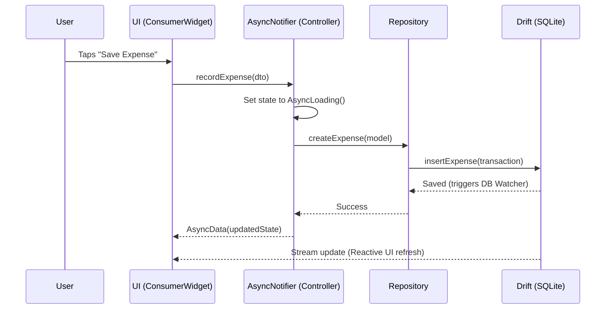
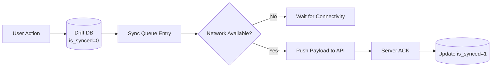

# Farm Project Manager (Farmivo)
# Technical Architecture Specification

**Version:** 1.0.0  
**Stack:** Flutter / Dart, Riverpod, Drift (SQLite), GoRouter, Freezed  
**Paradigm:** Clean Architecture + Feature-First (Offline-First Local-First)

---

## 1. Architectural Philosophy

Farmivo is engineered from the ground up as a **Local-First, Offline-First** application. The local SQLite database is the primary source of truth, not a local cache of a remote server. All computations, analytics, reports, and validations execute directly on the client device.

```
┌────────────────────────────────────────────────────────┐
│                      PRESENTATION                      │
│        Widgets, Pages, Dialogs, State Notifiers        │
└───────────────────────────▲────────────────────────────┘
                            │ (watches State & dispatches Commands)
┌───────────────────────────▼────────────────────────────┐
│                      APPLICATION                       │
│    Riverpod Notifiers, Controllers, Use Case Coordinators│
└───────────────────────────▲────────────────────────────┘
                            │ (invokes Domain Logic & Repositories)
┌───────────────────────────▼────────────────────────────┐
│                        DOMAIN                          │
│   Entities, Value Objects (Money), Financial Engine,   │
│          Health Scorer, Business Rules, Failures       │
└───────────────────────────▲────────────────────────────┘
                            │ (implements Repository Interfaces)
┌───────────────────────────▼────────────────────────────┐
│                         DATA                           │
│  Drift SQLite Database, Repositories, DAOs, Keyring,   │
│         File Storage, Offline Sync Queue               │
└────────────────────────────────────────────────────────┘
```

---

## 2. Directory & Package Structure

The project adopts a **Feature-First** structure where features encapsulate their own UI, presentation controllers, and domain use cases, while sharing a common core and data layer.

```text
lib/
├── app/                               # Application-level bootstrapping
│   ├── app.dart                       # Main MaterialApp.router entry
│   ├── bootstrap.dart                 # Initialization (Isolates, DB, Keyring)
│   ├── router/                        # GoRouter declarative configuration
│   │   ├── app_router.dart            # Route definitions & ShellRoute
│   │   ├── route_guards.dart          # Auth / PIN lock guards
│   │   └── routes.dart                # Typed route constants
│   └── theme/                         # High-contrast outdoor design system
│       ├── app_colors.dart            # Theme color tokens & contrast ratios
│       ├── app_typography.dart        # M3 typography configurations
│       └── app_theme.dart             # Light, Dark & High-Contrast OLED themes
│
├── core/                              # Cross-cutting primitives
│   ├── constants/                     # Currency codes, standard units
│   ├── errors/                        # AppFailure, DatabaseFailure, DomainException
│   ├── extensions/                    # DateTime, String, Iterable, Context helpers
│   ├── localization/                  # Generated l10n and formatters
│   ├── money/                         # Precision Money value object (minor units)
│   ├── security/                      # LocalAuth, PIN hashing, SecureStorage
│   └── utils/                         # Date helpers, math helpers, logger
│
├── data/                              # Data layer & storage implementation
│   ├── database/                      # Drift SQLite implementation
│   │   ├── app_database.dart          # Drift Database class definition
│   │   ├── tables/                    # Modular table definitions (22+ tables)
│   │   ├── daos/                      # Data Access Objects per domain
│   │   └── migrations/                # Versioned schema migrations
│   ├── repositories/                  # Concrete repository implementations
│   └── sync/                          # Offline sync queue engine
│       ├── sync_queue.dart            # Queue manager
│       └── sync_worker.dart           # Background sync processor
│
├── features/                          # Feature-first modules
│   ├── authentication/                # PIN & Biometrics lock
│   ├── dashboard/                     # Executive dashboard & high-level KPIs
│   ├── farms/                         # Farm properties management
│   ├── projects/                      # Project lifecycle & overview
│   ├── budgets/                       # Pre-season budget creation & planning
│   ├── expenses/                      # Quick expense tracking & variance
│   ├── activities/                    # Farm activity & agronomic logging
│   ├── harvests/                      # Harvest & inventory tracking
│   ├── sales/                         # Commercial sales, buyers & credit
│   ├── payments/                      # Receivables & installment tracking
│   ├── cash_flow/                     # Cash flow forecasting & liquidity
│   ├── scenarios/                     # Conservative vs Optimistic sensitivity
│   ├── reports/                       # PDF generation, CSV exports & charts
│   └── settings/                      # Local backup, restore, currency settings
│
└── shared/                            # Reusable widgets and UI components
    ├── widgets/                       # Buttons, Cards, Input fields, Badges
    ├── dialogs/                       # Confirmation, Quick Action, Void dialogs
    └── charts/                        # Donut, Bar, Line chart wrappers (fl_chart)
```

---

## 3. State Management with Riverpod

### 3.1 Architecture Principles
- Use **Code Generation** (`@riverpod`) for compile-time safety and dependency injection.
- UI components are pure `ConsumerWidget` or `ConsumerStatefulWidget` instances.
- State is modeled with `@freezed` immutable data classes.
- UI state updates are driven by streaming Drift reactive queries:
  `StreamProvider` connects directly to Drift DAOs (`watchAllExpenses()`, `watchProjectBudget()`).

### 3.2 State Flow Pattern


---

## 4. Local Database Architecture (Drift + SQLite)

### 4.1 Execution Isolation
- SQLite operations run in a **Background Isolate** using Drift's `IsolateSpawn` / `NativeDatabase.createInBackground` to guarantee that complex aggregations, PDF export queries, and financial variance scans never block the 60fps / 120fps UI thread.

### 4.2 Relational Integrity & Cascades
- Foreign keys are strictly enforced (`PRAGMA foreign_keys = ON;`).
- Projects belong to Farms (`ON DELETE RESTRICT` to prevent accidental loss of operational history).
- Budget items, Expenses, Harvests, and Sales belong to Projects (`ON DELETE RESTRICT` or soft-delete).

### 4.3 Soft Deletion & Immutability
- Financial transaction records (`expenses`, `sales`, `payments`) do not physically delete on user request.
- Records support an `is_voided` boolean flag, accompanied by `voided_at` and `void_reason`.
- Voided records remain in the database for audit trail fidelity and are excluded from active calculations via query scopes:
  ```sql
  WHERE is_voided = FALSE
  ```

---

## 5. Offline Synchronization Model (Phase 2 Ready)

The database schema includes native synchronization metadata for zero-friction future cloud sync without breaking existing local databases.



### Metadata Convention:
Every entity includes:
- `id`: `TEXT PRIMARY KEY` (UUID v4 generated client-side).
- `created_at`: `INTEGER` (Epoch milliseconds).
- `updated_at`: `INTEGER` (Epoch milliseconds).
- `is_synced`: `BOOLEAN DEFAULT 0`.
- `sync_version`: `INTEGER DEFAULT 1`.
- `is_deleted`: `BOOLEAN DEFAULT 0` (tombstone for cloud replication).

---

## 6. Security & Keyring Architecture

### 6.1 Authentication States
1. **Unprotected:** App opens directly into Dashboard (default upon first installation).
2. **PIN Protected:** Requires 4–6 digit PIN before displaying financial data.
3. **Biometric Protected:** Requires Fingerprint or Face ID via `local_auth`.

### 6.2 Keyring Storage
- Sensitive preferences and security tokens are stored using `flutter_secure_storage`:
  - **Android:** Stored in EncryptedSharedPreferences backed by Android Keystore.
  - **iOS:** Stored with `kSecAccessControlBiometryAny` in iOS Keychain.
- PIN values are salted with a per-device random salt and hashed using **Argon2id** or **SHA-256 with 50,000 iterations**. Raw PINs are never stored.

---

## 7. Performance & Scalability Targets

| Metric | Target Specification | Enforcement Mechanism |
| :--- | :--- | :--- |
| **Cold Start** | $<1.2\text{ seconds}$ on mid-range Android (Snapdragon 680 equivalent). | Lazy-loaded feature modules; background DB isolate. |
| **Expense Save Latency** | $<50\text{ ms}$ from tap to UI confirmation. | Synchronous isolate write; non-blocking reactive streams. |
| **Transaction Capacity** | $10,000+\text{ expenses}$, $5,000+\text{ sales}$ without frame drops. | Indexed foreign keys; paginated or streamed queries. |
| **Report Generation** | $<2.5\text{ seconds}$ for 10-page detailed PDF. | Background isolate computation of PDF binary chunks. |
| **Touch Latency** | Instant visual response ($<16\text{ ms}$). | High-contrast touch ripples and optimistic UI updates. |

