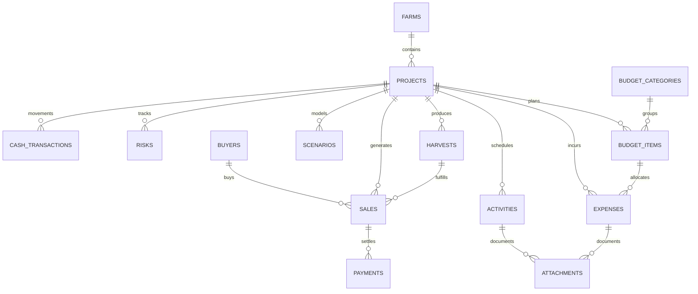

# Farm Project Manager (Farmivo)
# Database Schema Specification (Drift / SQLite)

**Engine:** SQLite via Drift (Dart ORM)  
**Storage Strategy:** Offline-First, UUID-Primary-Keys, Integer Minor Units (Pesewas) for Financial Precision  
**Integrity Mode:** Foreign Keys Enabled (`PRAGMA foreign_keys = ON;`), Soft Deletions & Audit Logging

---

## 1. Schema Conventions & Standards

1. **Primary Keys:** Standard UUID v4 strings (`TEXT PRIMARY KEY`).
2. **Financial Values:** Stored as `INTEGER` representing minor currency units (e.g., 100 GHS is stored as `10000` pesewas). Floating-point `REAL` types are strictly prohibited for monetary figures.
3. **Currencies:** Stored as 3-letter ISO-4217 uppercase strings (e.g., `'GHS'`, `'USD'`). Default: `'GHS'`.
4. **Timestamps:** Stored as `INTEGER` (Unix Epoch in milliseconds UTC) for deterministic cross-platform sorting and timezone independence.
5. **Sync Metadata:** Every table contains `created_at`, `updated_at`, `is_synced` (`BOOLEAN DEFAULT 0`), and `is_deleted` (`BOOLEAN DEFAULT 0`).
6. **Soft Deletions & Voiding:** Financial tables contain `is_voided` (`BOOLEAN DEFAULT 0`), `voided_at` (`INTEGER`), and `void_reason` (`TEXT`).

---

## 2. Entity-Relationship Overview



---

## 3. Comprehensive Table Specifications

### 3.1 `farms`
Stores agricultural landholdings and farm properties.

```sql
CREATE TABLE farms (
    id TEXT PRIMARY KEY NOT NULL,
    name TEXT NOT NULL,
    location TEXT NOT NULL,
    district TEXT,
    region TEXT NOT NULL,
    country TEXT NOT NULL DEFAULT 'Ghana',
    latitude REAL,
    longitude REAL,
    total_area REAL NOT NULL,
    area_unit TEXT NOT NULL DEFAULT 'Acres', -- 'Acres', 'Hectares', 'SqMeters'
    ownership_type TEXT NOT NULL,           -- 'Owned', 'Family', 'Rented', 'Leased', 'Abunu', 'Abusa', 'Other'
    notes TEXT,
    photo_path TEXT,
    created_at INTEGER NOT NULL,
    updated_at INTEGER NOT NULL,
    is_synced BOOLEAN NOT NULL DEFAULT 0,
    is_deleted BOOLEAN NOT NULL DEFAULT 0
);

CREATE INDEX idx_farms_region ON farms(region);
```

---

### 3.2 `projects`
Represents an individual agricultural enterprise or season cycle.

```sql
CREATE TABLE projects (
    id TEXT PRIMARY KEY NOT NULL,
    farm_id TEXT NOT NULL REFERENCES farms(id) ON DELETE RESTRICT,
    name TEXT NOT NULL,
    project_type TEXT NOT NULL,             -- 'Crop', 'Livestock', 'Aquaculture', 'Custom'
    commodity TEXT NOT NULL,                -- e.g. 'Pepper', 'Maize', 'Poultry', 'Tilapia'
    variety TEXT,                           -- e.g. 'Shito Pepper', 'Pioneer Maize', 'Cobb 500'
    land_size REAL NOT NULL,
    land_unit TEXT NOT NULL DEFAULT 'Acres',
    start_date INTEGER NOT NULL,
    expected_completion_date INTEGER,
    expected_first_harvest_date INTEGER,
    currency TEXT NOT NULL DEFAULT 'GHS',
    status TEXT NOT NULL DEFAULT 'PLANNING',-- 'PLANNING', 'ACTIVE', 'PRODUCTION', 'HARVESTING', 'SELLING', 'COMPLETED', 'ARCHIVED'
    description TEXT,
    notes TEXT,
    created_at INTEGER NOT NULL,
    updated_at INTEGER NOT NULL,
    is_synced BOOLEAN NOT NULL DEFAULT 0,
    is_deleted BOOLEAN NOT NULL DEFAULT 0
);

CREATE INDEX idx_projects_farm_id ON projects(farm_id);
CREATE INDEX idx_projects_status ON projects(status);
```

---

### 3.3 `budget_categories`
Taxonomy for grouping farm expenditures.

```sql
CREATE TABLE budget_categories (
    id TEXT PRIMARY KEY NOT NULL,
    name TEXT NOT NULL,                     -- e.g. 'Land Preparation', 'Inputs', 'Labour', 'Equipment', 'Logistics'
    description TEXT,
    icon_name TEXT,
    is_system_default BOOLEAN NOT NULL DEFAULT 0,
    display_order INTEGER NOT NULL DEFAULT 0,
    created_at INTEGER NOT NULL,
    updated_at INTEGER NOT NULL,
    is_synced BOOLEAN NOT NULL DEFAULT 0,
    is_deleted BOOLEAN NOT NULL DEFAULT 0
);
```

---

### 3.4 `budget_items`
Pre-season planned allocations and costs per category.

```sql
CREATE TABLE budget_items (
    id TEXT PRIMARY KEY NOT NULL,
    project_id TEXT NOT NULL REFERENCES projects(id) ON DELETE CASCADE,
    category_id TEXT NOT NULL REFERENCES budget_categories(id) ON DELETE RESTRICT,
    name TEXT NOT NULL,                     -- e.g. 'NPK Fertilizer 15:15:15'
    description TEXT,
    quantity REAL NOT NULL,
    unit TEXT NOT NULL,                     -- e.g. '50kg Bag', 'Acre', 'Man-day'
    unit_cost_minor INTEGER NOT NULL,       -- Stored in minor units (Pesewas)
    planned_amount_minor INTEGER NOT NULL,  -- quantity * unit_cost_minor
    currency TEXT NOT NULL DEFAULT 'GHS',
    status TEXT NOT NULL DEFAULT 'PLANNED', -- 'PLANNED', 'PARTIAL', 'COMMITTED', 'COMPLETED'
    created_at INTEGER NOT NULL,
    updated_at INTEGER NOT NULL,
    is_synced BOOLEAN NOT NULL DEFAULT 0,
    is_deleted BOOLEAN NOT NULL DEFAULT 0
);

CREATE INDEX idx_budget_items_project ON budget_items(project_id);
CREATE INDEX idx_budget_items_category ON budget_items(category_id);
```

---

### 3.5 `expenses`
Transactional ledger of actual money disbursed.

```sql
CREATE TABLE expenses (
    id TEXT PRIMARY KEY NOT NULL,
    project_id TEXT NOT NULL REFERENCES projects(id) ON DELETE RESTRICT,
    category_id TEXT NOT NULL REFERENCES budget_categories(id) ON DELETE RESTRICT,
    budget_item_id TEXT REFERENCES budget_items(id) ON DELETE SET NULL,
    activity_id TEXT,                       -- Optional foreign key linking to activities(id)
    transaction_date INTEGER NOT NULL,
    description TEXT NOT NULL,
    quantity REAL NOT NULL DEFAULT 1.0,
    unit TEXT,
    unit_cost_minor INTEGER,
    amount_minor INTEGER NOT NULL,          -- In minor units (Pesewas)
    currency TEXT NOT NULL DEFAULT 'GHS',
    payment_method TEXT NOT NULL,           -- 'CASH', 'MOMO', 'BANK', 'CREDIT', 'OTHER'
    vendor_name TEXT,
    receipt_photo_path TEXT,
    notes TEXT,
    is_voided BOOLEAN NOT NULL DEFAULT 0,
    voided_at INTEGER,
    void_reason TEXT,
    created_at INTEGER NOT NULL,
    updated_at INTEGER NOT NULL,
    is_synced BOOLEAN NOT NULL DEFAULT 0,
    is_deleted BOOLEAN NOT NULL DEFAULT 0
);

CREATE INDEX idx_expenses_project ON expenses(project_id);
CREATE INDEX idx_expenses_category ON expenses(category_id);
CREATE INDEX idx_expenses_date ON expenses(transaction_date);
CREATE INDEX idx_expenses_voided ON expenses(is_voided);
```

---

### 3.6 `activities`
Field operations, agronomic records, and casual labour tracking.

```sql
CREATE TABLE activities (
    id TEXT PRIMARY KEY NOT NULL,
    project_id TEXT NOT NULL REFERENCES projects(id) ON DELETE CASCADE,
    activity_type TEXT NOT NULL,            -- 'Ploughing', 'Planting', 'Spraying', 'Fertilizing', 'Weeding', 'Harvesting', etc.
    title TEXT NOT NULL,
    activity_date INTEGER NOT NULL,
    description TEXT,
    labour_count INTEGER NOT NULL DEFAULT 0,
    duration_hours REAL,
    cost_minor INTEGER NOT NULL DEFAULT 0,  -- In minor units
    currency TEXT NOT NULL DEFAULT 'GHS',
    status TEXT NOT NULL DEFAULT 'COMPLETED',-- 'PLANNED', 'IN_PROGRESS', 'COMPLETED', 'CANCELLED'
    notes TEXT,
    created_at INTEGER NOT NULL,
    updated_at INTEGER NOT NULL,
    is_synced BOOLEAN NOT NULL DEFAULT 0,
    is_deleted BOOLEAN NOT NULL DEFAULT 0
);

CREATE INDEX idx_activities_project_date ON activities(project_id, activity_date);
```

---

### 3.7 `harvests`
Physical yield collections and inventory batches.

```sql
CREATE TABLE harvests (
    id TEXT PRIMARY KEY NOT NULL,
    project_id TEXT NOT NULL REFERENCES projects(id) ON DELETE RESTRICT,
    batch_number TEXT NOT NULL,
    harvest_date INTEGER NOT NULL,
    product_name TEXT NOT NULL,
    quantity REAL NOT NULL,
    unit TEXT NOT NULL,                     -- 'kg', '50kg Bag', '100kg Bag', 'Crate', 'Tonne'
    grade TEXT,                             -- 'Grade A', 'Grade B', 'Rejects'
    storage_location TEXT,
    notes TEXT,
    photo_path TEXT,
    created_at INTEGER NOT NULL,
    updated_at INTEGER NOT NULL,
    is_synced BOOLEAN NOT NULL DEFAULT 0,
    is_deleted BOOLEAN NOT NULL DEFAULT 0
);

CREATE INDEX idx_harvests_project_date ON harvests(project_id, harvest_date);
```

---

### 3.8 `buyers`
Customers, off-takers, wholesale aggregators, and market queens.

```sql
CREATE TABLE buyers (
    id TEXT PRIMARY KEY NOT NULL,
    name TEXT NOT NULL,
    phone TEXT,
    business_name TEXT,
    location TEXT,
    notes TEXT,
    created_at INTEGER NOT NULL,
    updated_at INTEGER NOT NULL,
    is_synced BOOLEAN NOT NULL DEFAULT 0,
    is_deleted BOOLEAN NOT NULL DEFAULT 0
);

CREATE INDEX idx_buyers_name ON buyers(name);
```

---

### 3.9 `sales`
Commercial sales agreements and commodity dispatches.

```sql
CREATE TABLE sales (
    id TEXT PRIMARY KEY NOT NULL,
    project_id TEXT NOT NULL REFERENCES projects(id) ON DELETE RESTRICT,
    buyer_id TEXT REFERENCES buyers(id) ON DELETE SET NULL,
    harvest_id TEXT REFERENCES harvests(id) ON DELETE SET NULL,
    sale_date INTEGER NOT NULL,
    product_name TEXT NOT NULL,
    quantity REAL NOT NULL,
    unit TEXT NOT NULL,
    unit_price_minor INTEGER NOT NULL,      -- Minor units
    total_amount_minor INTEGER NOT NULL,    -- quantity * unit_price_minor
    currency TEXT NOT NULL DEFAULT 'GHS',
    payment_status TEXT NOT NULL DEFAULT 'UNPAID', -- 'PAID', 'PARTIAL', 'UNPAID'
    notes TEXT,
    is_voided BOOLEAN NOT NULL DEFAULT 0,
    voided_at INTEGER,
    void_reason TEXT,
    created_at INTEGER NOT NULL,
    updated_at INTEGER NOT NULL,
    is_synced BOOLEAN NOT NULL DEFAULT 0,
    is_deleted BOOLEAN NOT NULL DEFAULT 0
);

CREATE INDEX idx_sales_project ON sales(project_id);
CREATE INDEX idx_sales_buyer ON sales(buyer_id);
CREATE INDEX idx_sales_date ON sales(sale_date);
CREATE INDEX idx_sales_status ON sales(payment_status);
```

---

### 3.10 `payments`
Liquid cash collected against sales agreements.

```sql
CREATE TABLE payments (
    id TEXT PRIMARY KEY NOT NULL,
    sale_id TEXT NOT NULL REFERENCES sales(id) ON DELETE RESTRICT,
    payment_date INTEGER NOT NULL,
    amount_minor INTEGER NOT NULL,          -- In minor units
    currency TEXT NOT NULL DEFAULT 'GHS',
    payment_method TEXT NOT NULL,           -- 'CASH', 'MOMO', 'BANK', 'OTHER'
    reference_number TEXT,                  -- MoMo transaction ID or Bank ref
    notes TEXT,
    is_voided BOOLEAN NOT NULL DEFAULT 0,
    voided_at INTEGER,
    void_reason TEXT,
    created_at INTEGER NOT NULL,
    updated_at INTEGER NOT NULL,
    is_synced BOOLEAN NOT NULL DEFAULT 0,
    is_deleted BOOLEAN NOT NULL DEFAULT 0
);

CREATE INDEX idx_payments_sale ON payments(sale_id);
CREATE INDEX idx_payments_date ON payments(payment_date);
```

---

### 3.11 `cash_transactions`
General liquidity movements (Capital contributions, Owner withdrawals, Loan advances).

```sql
CREATE TABLE cash_transactions (
    id TEXT PRIMARY KEY NOT NULL,
    project_id TEXT REFERENCES projects(id) ON DELETE SET NULL,
    transaction_type TEXT NOT NULL,         -- 'CASH_IN', 'CASH_OUT'
    category TEXT NOT NULL,                 -- 'Capital Injection', 'Sale Payment', 'Expense Disbursal', 'Owner Drawing', 'Loan Inflow'
    transaction_date INTEGER NOT NULL,
    amount_minor INTEGER NOT NULL,
    currency TEXT NOT NULL DEFAULT 'GHS',
    reference_id TEXT,                      -- Link to expense_id, payment_id, etc.
    notes TEXT,
    created_at INTEGER NOT NULL,
    updated_at INTEGER NOT NULL,
    is_synced BOOLEAN NOT NULL DEFAULT 0,
    is_deleted BOOLEAN NOT NULL DEFAULT 0
);

CREATE INDEX idx_cash_tx_date ON cash_transactions(transaction_date);
```

---

### 3.12 `scenarios`
Risk and sensitivity forecasts (Worst, Expected, Best cases).

```sql
CREATE TABLE scenarios (
    id TEXT PRIMARY KEY NOT NULL,
    project_id TEXT NOT NULL REFERENCES projects(id) ON DELETE CASCADE,
    scenario_type TEXT NOT NULL,            -- 'CONSERVATIVE', 'EXPECTED', 'OPTIMISTIC'
    expected_yield REAL NOT NULL,
    yield_unit TEXT NOT NULL,
    expected_unit_price_minor INTEGER NOT NULL,
    projected_revenue_minor INTEGER NOT NULL,
    projected_cost_minor INTEGER NOT NULL,
    projected_profit_minor INTEGER NOT NULL,
    projected_roi_percent REAL NOT NULL,
    notes TEXT,
    created_at INTEGER NOT NULL,
    updated_at INTEGER NOT NULL,
    is_synced BOOLEAN NOT NULL DEFAULT 0,
    is_deleted BOOLEAN NOT NULL DEFAULT 0
);

CREATE INDEX idx_scenarios_project ON scenarios(project_id);
```

---

### 3.13 `risks`
Operational and agronomic risks management ledger.

```sql
CREATE TABLE risks (
    id TEXT PRIMARY KEY NOT NULL,
    project_id TEXT NOT NULL REFERENCES projects(id) ON DELETE CASCADE,
    risk_title TEXT NOT NULL,
    category TEXT NOT NULL,                 -- 'Weather', 'Pest/Disease', 'Market/Price', 'Labour', 'Theft', 'Logistics'
    probability INTEGER NOT NULL,           -- Scale 1-5
    impact INTEGER NOT NULL,                -- Scale 1-5
    risk_score INTEGER NOT NULL,            -- probability * impact (1-25)
    mitigation_strategy TEXT,
    status TEXT NOT NULL DEFAULT 'IDENTIFIED', -- 'IDENTIFIED', 'MITIGATED', 'OCCURRED', 'CLOSED'
    notes TEXT,
    created_at INTEGER NOT NULL,
    updated_at INTEGER NOT NULL,
    is_synced BOOLEAN NOT NULL DEFAULT 0,
    is_deleted BOOLEAN NOT NULL DEFAULT 0
);

CREATE INDEX idx_risks_project ON risks(project_id);
```

---

### 3.14 `audit_logs`
Immutable forensic ledger of modifications to financial and operational records.

```sql
CREATE TABLE audit_logs (
    id TEXT PRIMARY KEY NOT NULL,
    entity_table TEXT NOT NULL,
    entity_id TEXT NOT NULL,
    action TEXT NOT NULL,                   -- 'CREATE', 'UPDATE', 'VOID', 'DELETE'
    previous_state_json TEXT,
    new_state_json TEXT,
    performed_by TEXT NOT NULL DEFAULT 'local_user',
    reason TEXT,
    timestamp INTEGER NOT NULL
);

CREATE INDEX idx_audit_entity ON audit_logs(entity_table, entity_id);
CREATE INDEX idx_audit_timestamp ON audit_logs(timestamp);
```

---

### 3.15 `sync_queue`
Idempotent queue for offline-first transactional replication.

```sql
CREATE TABLE sync_queue (
    id TEXT PRIMARY KEY NOT NULL,
    entity_table TEXT NOT NULL,
    entity_id TEXT NOT NULL,
    operation TEXT NOT NULL,                -- 'INSERT', 'UPDATE', 'DELETE'
    payload_json TEXT NOT NULL,
    retry_count INTEGER NOT NULL DEFAULT 0,
    last_error TEXT,
    queued_at INTEGER NOT NULL,
    status TEXT NOT NULL DEFAULT 'PENDING'  -- 'PENDING', 'PROCESSING', 'FAILED', 'COMPLETED'
);

CREATE INDEX idx_sync_queue_status ON sync_queue(status, queued_at);
```

---

### 3.16 `app_settings`
Key-value store for offline configuration, biometric settings, and profile info.

```sql
CREATE TABLE app_settings (
    setting_key TEXT PRIMARY KEY NOT NULL,
    setting_value TEXT NOT NULL,
    updated_at INTEGER NOT NULL
);
```

